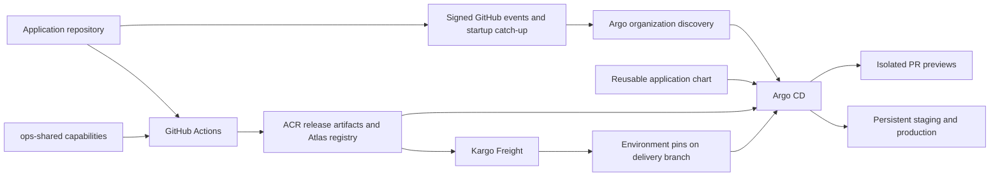

# Application delivery platform design

**Scope:** reusable application delivery on Azure AKS, from PR preview to
persistent environments and isolated database recovery.
**Evidence date:** 9 November 2026.

The platform centralises delivery templates rather than copying infrastructure
into each application repository. An application declares its components,
health endpoints and logical database requirements. Shared templates derive
resource identities, credentials, Argo registrations and deployment ordering.
The `preview-environments` application is the acceptance-test consumer.

The ten delivery stages have passed their functional acceptance gates. This is
a demonstration platform with a small dataset, not a production availability or
scale certification. Hosted SRE agents and the financial-document application
are separate consumers/workstreams, outside this document's completion claim.

## Goals and boundaries

- Onboard another supported repository through application intent, without a
  per-application registration list or copied infrastructure in GitOps.
- Isolate PR resources across repository identities and PR numbers. Preserve
  persistent environment identities and data across release changes.
- Publish and deploy a coherent immutable release, verify the running result,
  then promote that same release through independently pinned environments.
- Separate application rollback, schema downgrade and data recovery.
- Reconstruct registrations after bootstrap and clean up dependent resources
  before their controllers, credentials and foundation infrastructure.

Production HA, automatic database failover, zero-RPO guarantees, arbitrary
application/database support and comprehensive failure-case testing are outside
the delivered acceptance scope. Kubernetes NetworkPolicies remain excluded from
reconciliation; namespace and identity boundaries do not imply enforced network
isolation.

## Repository ownership

| Repository | Owns |
| --- | --- |
| [`terraform`](https://github.com/ai-platform-portfolio/terraform) | Reusable foundation modules. Bootstrap deployment choices belong to the caller. |
| [`gitops`](README.md) | Management bootstrap, shared packages, controllers, service configuration and policies. No application-specific registrations or delivery definitions. |
| [`application-helm-chart`](https://github.com/ai-platform-portfolio/application-helm-chart) | Reusable application, Argo, database, identity, credential, RBAC, TLS, test and cleanup templates with safe defaults. |
| [`ops-shared`](https://github.com/ai-platform-portfolio/ops-shared) | Composable callable CI workflows/actions. Callers select their job graph and publication policy. |
| [Application repositories](https://github.com/ai-platform-portfolio/preview-environments) | Application code, SQL migrations, tests, minimal deployment intent and thin CI callers. |

Terraform owns AKS/bootstrap foundations and, as an explicit current exception,
the shared managed PostgreSQL source server. ASO owns supported service children,
application databases and workload identities. Atlas owns SQL roles, access
migrations and application migrations through distinct resources. These owners
must not reconcile the same object concurrently.

The AKS administrator Entra group is an existing operator-managed group looked
up by bootstrap. Its PostgreSQL administrator assignment is Terraform-owned;
Atlas has a separate ASO-owned administrator child. Replacing an object or moving
ownership requires an explicit state/ownership plan.

## Architecture



Argo CD reconciles desired Kubernetes state. ApplicationSets generate
registrations and environment Applications. Argo Events refreshes discovery on
relevant GitHub events and startup. Kargo selects release artifacts and writes
persistent environment pins. Rollouts controls candidate traffic; Atlas gates
schema readiness; Testkube/Playwright verifies the deployed application.

## Developer interface and generated identity

A minimal application intent declares a component and logical database:

```yaml
name: ledger
components:
  api:
    image: registry.example.test/ledger-api@sha256:aaaaaaaaaaaaaaaaaaaaaaaaaaaaaaaaaaaaaaaaaaaaaaaaaaaaaaaaaaaaaaaa
    port: 8080
    readinessPath: /api/readyz
    database: messages
databases:
  messages:
    migration:
      repository: ledger-migrations
      tag: immutable-source-sha
```

This is an interface example, not a runnable image or published migration.
Publication supplies real digest-pinned images and the migration source SHA.
Registration intent lives in `deploy/previews.yaml` and
`deploy/environments.yaml`; platform discovery supplies repository identity and
environment metadata. See the chart's
[minimal intent examples](https://github.com/ai-platform-portfolio/application-helm-chart/tree/main/examples).

Names derive from repository identity, PR/environment identity, release name
and logical resource keys. Readable prefixes plus hashes distinguish repositories
with the same PR number and avoid truncation collisions between resource names.
Developers do not supply generated database names, role maps or preview secrets.
Persistent namespaces/databases remain stable while their selected versions change.

Registration is a separate render/reconciliation boundary. Child application
releases disable self-registration. Kargo resources have one delivery Application
owner; registration and nested delivery must not both own them.

## Immutable publication and deployed merge gate

The application caller composes the shared Docker workflow and official Atlas
actions. It owns event policy, dependencies and the combined artifact record.
Images are pinned by digest, migrations by source revision/checksum, and the
packaged application chart contains the matching release values. Argo consumes
that coherent release instead of independently following floating image tags.
Pinned workflow/action revisions and explicit source-SHA checks protect the
publication path; this is not a claim of a complete signed supply-chain framework.

Azure publication uses native GitHub OIDC and scoped `id-token: write` with the
existing organisation identity. CI does not receive production database login
credentials. Trusted same-repository PRs can publish preview artifacts; fork and
untrusted branch paths do not receive the same publication authority.

The deployed browser gate runs after migration and workload readiness. Its
checks match the expected digest-pinned images to Ready running pods, then
exercise browser save/reload/read through the actual frontend, API and database.
The resulting `deployed-playwright` status belongs to the current PR head.
Head/revision checks prevent an older deployment from being accepted merely
because its endpoint responds. The live stale-head negative cases remain a
separate evidence gap.

## Event-driven onboarding and preview lifecycle

Shared [organization discovery](helm_chart/platform/templates/application-onboarding.yaml)
finds repositories containing the declared intent files. It generates a
registration Application using the unchanged shared chart and repository-owned
values. The chart's PR ApplicationSet then creates each isolated preview.

Organization/PR discovery polling is disabled. Signed GitHub `pull_request`,
`workflow_run` and `push` events use the existing Argo Events bus and refresh
mechanism. Startup catch-up reconstructs registrations after rebuild. This does
not disable Kubernetes controller retries or Kargo's native registry scan interval.
It also does not guarantee automatic redelivery of every lost external event;
replay/missed-event failure cases remain to be proved.

Preview creation and updates follow database/credential/migration/workload/test
readiness. Closing a PR removes its generated Application and invokes chart-owned
cleanup before the namespace and shared dependencies disappear. The shared
platform, other previews and persistent environments retain their ownership.

## Database and credential model

| Environment | Database placement | Runtime authentication | Intended lifetime |
| --- | --- | --- | --- |
| PR preview | Separate database and scoped roles on shared CNPG PostgreSQL | Per-preview client certificate | PR lifetime |
| Staging | Separate database on shared Azure PostgreSQL Flexible Server | Entra workload identity | Independent of release version |
| Production demonstration | Separate database on the same managed server | Separate Entra workload identity | Independent of release version |
| Recovery drill | Separate ASO-owned restored server and private endpoint | Short-lived Entra credentials | Explicit operator drill |

CNPG preview certificates have distinct SQL identities. The platform's Atlas
client identity can map only to generated migrator logins; runtime certificates
must identify the exact runtime login. A wildcard public HTTPS certificate is
not a database client identity. The chart owns certificate issuance/delivery,
permissions and cleanup; Atlas retains SQL role ownership.

Managed PostgreSQL uses ASO workload identities and federated credentials, with
verified TLS to its private hostname. Runtime users have restricted application
permissions; they do not create databases, roles or schemas. Atlas's managed
identity has server-wide SQL authority, so custom Atlas configuration is a trusted
platform boundary. Database separation is logical, not separate compute or failure
domains. Sharing one small server is a deliberate demonstration cost tradeoff.

Atlas resources separate three responsibilities:

1. Declarative role ownership with an explicit scope.
2. Append-only identity/access migration histories.
3. Application-object migration history from the Atlas registry.

The streams use separate revision schemas and do not reconcile each other's
objects or grants. A successful resource must be Ready for its current generation
before later Argo waves proceed. Runtime code never creates its schema.

Key Vault/ESO supply platform credentials and short-lived GitHub installation
tokens. Runtime Azure access uses workload identity rather than client secrets.
GitHub App private keys and webhook HMAC remain explicit long-lived exceptions;
database bootstrap credentials also have a lifecycle tied to their owning store.
Named Secret reads reduce exposure, but privileged platform controllers remain
trusted. Automatic rotation/revocation of every retained issuer credential is
not claimed.

## Promotion, canary and rollback

Kargo's Warehouse discovers published main OCI application charts as Freight.
A staging promotion writes `deploy/environments/staging/release.yaml` on the
application's `delivery` branch. Production consumes Freight verified in staging
and writes its own release pin. Argo remains the deployment executor; GitHub
Actions publishes artifacts rather than deploying the environments.

Kargo verification checks the requested deployed release, not just endpoint
reachability. Recreated Stages initially have no verification history even when
the delivery branch restores their release pins. The acceptance run explicitly
promoted the already-selected Freight through staging and production using the
native templates; that history was not assumed to survive teardown.

Chart-owned Rollouts use the installed Gateway API traffic-routing plugin to
change HTTPRoute backend weights. Candidate analysis checks the candidate's
readiness endpoint; readiness/deadline failures abort and retain stable traffic.
The demonstrated probe is not a statistical SLO or production load gate.

Durable application rollback selects an earlier immutable release in desired
state, reconciles it and verifies browser/data health. It does not revert SQL.
Applications therefore need schema compatibility across rollout/rollback windows;
expand/contract schema design remains necessary for real destructive changes.
The demonstrated rollback used compatible migration history. If an older release
also selects a directory missing already-applied migrations, Atlas's default down
guard can stop reconciliation before workload rollback. A reviewed forward
corrective release retaining migration history is required in that case; a
universal independent schema-pin rollback mechanism is not claimed.

## Protected schema downgrade and isolated PITR

Schema down is blocked by default. It is an operator-reviewed action separate
from application rollback, and inline identity/access down stays blocked. The
proved case reverses only a table comment on an isolated restored database.
It does not demonstrate arbitrary data-reversing migrations.

Remote down requires the registry's untagged `latest` directory to contain every
reverted migration. Operator 0.8.4 uses it to calculate the inverse even when the
resource selects an older target tag. Main publication supplies that history;
a preview must not move `latest`. Protected Atlas Cloud policy requires actual
human approval, with `autoApprove` disabled.

Managed migration configuration keeps Entra token acquisition in Atlas HCL. When
remote down is explicitly enabled, the fixed shared chart also supplies non-secret
driver/scope metadata so the operator can create its native isolated dev database.
An explicit dev URL retains precedence. The dev database is not the target or a
copy of application data; it is disposable planning capacity. Existing immutable
release packages do not acquire later chart fixes automatically.

The [recovery package](helm_chart/platform/packages/postgres-recovery/README.md)
restores the whole managed source into separate ASO-owned capacity. Argo orders
the server, endpoint/administrators and DNS attachment. Validation uses normal
private DNS and hostname-verified TLS, with no source connection switch:

1. Capture source data and all migration histories around a selected restore point.
2. Confirm the copy contains before-point data and excludes after-point markers.
3. Validate the source still contains those markers and remains ready.
4. Only then run the approved schema test against the copy, require human
   approval, and compare data/history again.
5. Delete test Atlas/dev/RBAC resources, disable recovery, and wait for normal
   Argo/ASO cleanup. Verify Azure server/endpoint/DNS absence independently.

The source remains Terraform-owned. Recovery data and administrators are not
adopted as new application-owned databases. See
[Atlas prerequisites](helm_chart/platform/packages/atlas/README.md) and the
[application chart's database contract](https://github.com/ai-platform-portfolio/application-helm-chart#optional-postgresql-and-atlas-resources).

## Bootstrap, reconciliation and teardown

[Bootstrap](bootstrap/README.md) creates foundations and the initial Argo release.
The lifecycle command seeds runtime metadata, credentials and shared root state,
then waits for package health and current-source registrations. Partial bootstrap
commands compose existing foundations; persistent-environment discovery requires
the managed server before its Atlas binding is enabled.

A running Argo operation can retain an older revision while a new main commit
contains its fix. The shared lifecycle has a stale-operation handler and resumes
against the compared current revision. The final cleanup used that normal resume
path explicitly. Automatic event-only preemption of every blocked operation has
not been demonstrated.

Teardown drains previews/applications, SQL cleanup and ASO dependencies while
their operators and credentials are still available. It then removes platform
packages and disposable foundation resources. Finalizer removal is not a normal
cleanup mechanism. Application data is disposable on full teardown; the separate
Terraform state backend persists. Deleting Kubernetes Atlas resources does not
by itself prove SQL objects or Atlas Cloud historical records are removed.

ASO grants include the declared scope in their Kubernetes identity when a scope
change requires replacement: Azure role names/owner scopes are immutable.
Normal creation plus `PruneLast` avoids attempting an invalid in-place update.
An existing same-scope resource under a legacy name still needs an explicit
ownership-transfer review; two CRs must not own the same Azure grant.

## Reliability decisions and acceptance evidence

AKS Free-tier control-plane overload and automatic restarts were confirmed by
Azure diagnostics. Argo WATCH retry amplification was reproduced against its
exact client dependency. The platform now uses Standard control-plane capacity,
bounded LIST concurrency and a digest-pinned temporary Argo controller build
with deletion-hook and WATCH-backoff fixes. See the
[backport and configuration rationale](bootstrap/README.md).
These changes add maintenance ownership; adopt a suitable upstream release and
remove the overrides after the same regression gates pass. Worker scaling alone
does not directly enlarge the managed API server.

Observed acceptance on 9 November 2026:

| Capability | Evidence | Limit |
| --- | --- | --- |
| Rebuild/onboarding | Native rebuild recreated shared packages and two open PR registrations; final normal lifecycle resume exited successfully | Not all missed-event/stale-head/cross-repository negative cases were exercised live |
| Persistent delivery | Separate databases/identities, successful deployed browser hooks, both Kargo Stages Verified | Shared server; demonstration traffic and dataset |
| Canary/rollback | Passing candidate, failing/aborted candidate and durable prior-release selection verified | Not a load or SLO certification |
| PITR | Both restored datasets and all six histories matched; after-point markers excluded and source preserved | Request-to-SQL 17m39.3s included reconciliation delay; server-CR-to-SQL 9m20.6s |
| Protected down | Actual ApprovalPending, human approval, comment removal and unchanged rows/original histories | Metadata-only inverse on isolated capacity |
| Cleanup | Test/dev resources, five ASO CRs, recovery App and actual Azure server/endpoint/DNS removed | Explicit normal lifecycle resume was needed for a stale root operation |
| Final health | 73/73 Argo Applications Synced/Healthy; both source readiness endpoints successful | Point-in-time observation |

The latest recovered record's transaction timestamp was about 4m48.7s before the
selected point. That is an observed record timestamp, not an exact commit-based,
maximum or zero-RPO guarantee. ASO's controller did not restart during the drill;
a transient busy-server delete recovered through its native retry path.

Remaining limits are tracked explicitly: cross-repository and missed-event
negative proofs, Argo comparison/cache latency, upgrade quota headroom, and Atlas
Cloud tracking behavior for restored copies. A restored revision table includes
Atlas's bookkeeping identifier; physical SQL isolation was verified, while Cloud
tracking-record isolation and automatic historical-record cleanup were not.

Implementation references:

- [Persistent environment activation, GitOps PR130](https://github.com/ai-platform-portfolio/gitops/pull/130).
- [Publisher scope identity, PR132](https://github.com/ai-platform-portfolio/gitops/pull/132) and [Holmes scope identity, PR134](https://github.com/ai-platform-portfolio/gitops/pull/134).
- [Native managed migration dev wiring, chart PR33](https://github.com/ai-platform-portfolio/application-helm-chart/pull/33).
- [Comment-only acceptance migration, application PR20](https://github.com/ai-platform-portfolio/preview-environments/pull/20).
