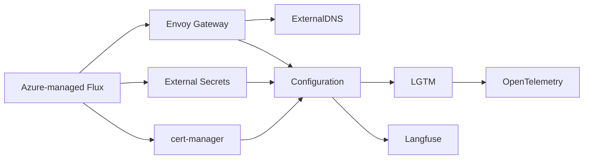

# AKS GitOps

Minimal Flux installs for the Azure dev cluster. Terraform is maintained separately in
[michaelalinks/portfolio-infra](https://github.com/michaelalinks/portfolio-infra), in `main.tf`.
Azure's managed `microsoft.flux` extension owns the Flux controllers and Git source.

## Reconciliation

`flux/flux-system/platform.yaml` contains seven packages and one configuration phase:



Controllers reconcile first. Configuration then creates the Azure Key Vault store,
Grafana SSO secret, Let's Encrypt issuer, wildcard certificate and public Gateway.
It waits for the store, secret, certificate and Gateway before starting LGTM.
Keeping custom resources behind their controllers prevents an empty cluster from
failing Flux's dry-run validation before the CRDs have been installed.

ExternalDNS reads Gateway HTTPRoutes and manages only `dev.michaelalinks.com`, with
TXT ownership `aks-dev`. Grafana is exposed at `https://grafana.dev.michaelalinks.com`;
HTTP redirects to HTTPS. Other namespaces can use the shared Gateway by adding
the label `dev.michaelalinks.com/gateway: public`.

## Observability

LGTM uses maintained, individually pinned charts for Loki, Grafana, Tempo and Mimir.
Grafana's `k8s-monitoring` chart configures its own Alloy collector for Kubernetes
metrics and pod logs. There is no separate Alloy release
or copied collector configuration.

Loki and Tempo run as single replicas. Mimir uses its supported classic architecture
with one ingester and no Kafka or MinIO. The remaining values configure Azure
storage, service accounts, Grafana authentication and the minimum dev deployment.

The official OpenTelemetry Collector chart forwards application traces to Tempo,
metrics to Mimir and logs to Loki. Applications can send OTLP to
`opentelemetry-collector.opentelemetry.svc.cluster.local`
on port `4317` (gRPC) or `4318` (HTTP). Applications must emit telemetry themselves;
the chart does not automatically instrument them.

Loki, Mimir and Tempo persist their object data in Azure Blob Storage. Grafana and
backend working data use PVCs. PVCs survive pod restarts, but are not a backup for
cluster deletion: export Grafana dashboards or back up its database if you need
to retain changes made through the UI. The previous cluster's data is not migrated.

## Langfuse

The [official Langfuse chart](https://langfuse.com/self-hosting/deployment/kubernetes-helm)
serves `https://langfuse.dev.michaelalinks.com` through the shared TLS Gateway.
It includes PostgreSQL, Valkey, SeaweedFS, ClickHouse and a single Keeper replica
for this dev cluster. The ClickHouse operator and Langfuse share one Flux phase;
Langfuse's HelmRelease waits for the operator, while the phase waits for cert-manager
and the public Gateway through `configuration`. No additional operator phase is needed.

Use built-in accounts, create a Langfuse project, and configure its SDK with the
project API keys and public URL. Application OTLP sent to the collector goes to
Tempo; it is not automatically copied into a Langfuse project. The chart generates
its initial secrets. Langfuse data uses PVCs: back up data and secrets before
cluster deletion if you want to retain projects, traces and accounts.

## Azure bootstrap

The Terraform Flux configuration must use name and namespace `flux-system`, Git
repository `https://github.com/ai-platform-portfolio/gitops.git`, branch `main`,
and path `./flux`. Its root Kustomization uses `wait = false`; child Kustomizations
perform the readiness checks.

Terraform passes six non-secret values through `post_build.substitute` into
`flux/flux-system/cluster-settings.yaml`:

- `AZURE_TENANT_ID` and `AZURE_SUBSCRIPTION_ID`
- `AZURE_DNS_CLIENT_ID` for ExternalDNS and cert-manager
- `AZURE_KEY_VAULT_CLIENT_ID` for External Secrets
- `AZURE_STORAGE_CLIENT_ID` and `AZURE_STORAGE_ACCOUNT` for LGTM

The Key Vault `localdevenv` must contain enabled `grafana-sso-client-id` and
`grafana-sso-client-secret` secrets. The existing Entra application needs the callback
`https://grafana.dev.michaelalinks.com/login/azuread`.

## Cluster recreation

1. Merge the GitOps PR before applying the infrastructure PR, because Flux reads `main`.
2. Delete only the old AKS cluster, preserving resource group `kubernetes`, its VNet,
   delegated Azure DNS zone and Key Vault. Keep the new Blob Storage account for
   subsequent rebuilds. Review the old Terraform state before retiring its cluster
   resources so it cannot later recreate or manage the replacement cluster.
3. In `portfolio-infra`, initialize Terraform, review the plan and apply it when ready.
   The configuration creates the cluster, identities, roles and federation before
   connecting managed Flux. Use an AKS version supported by the pinned charts
   (Kubernetes 1.32 or newer).
4. Confirm Flux readiness, Gateway/TLS, Grafana Entra login, and metrics/log ingestion:

   ```sh
   kubectl -n flux-system get kustomizations
   kubectl get helmreleases -A
   kubectl -n envoy-gateway-system get gateway,certificate
   kubectl -n lgtm get httproutes
   kubectl -n monitoring get alloys
   kubectl -n opentelemetry get deployments,services
   kubectl -n langfuse get clickhouseclusters,keeperclusters,httproutes
   ```

Federation is recreated against the new cluster's OIDC issuer; client IDs come from
Terraform rather than being copied from the old manifests. The existing delegated
DNS zone is referenced rather than recreated, so its name servers remain unchanged.
ExternalDNS can manage records it owns; records belonging to the old deployment's
TXT owner need deliberate cleanup if they conflict with the new hostname.

## Validation

With Python 3.12+, Helm 3 and kubectl installed:

```sh
python3 -m venv .venv
.venv/bin/pip install -r scripts/requirements.txt
.venv/bin/python scripts/validate.py
```

CI runs the same checks: Kustomize builds, chart lint/rendering, custom-resource
schemas, dependency cycles, CRD prerequisites (including Helm dependency ordering) and HTTPRoute backend service/port.
Validation downloads pinned charts and Flux schemas and does not contact AKS.
