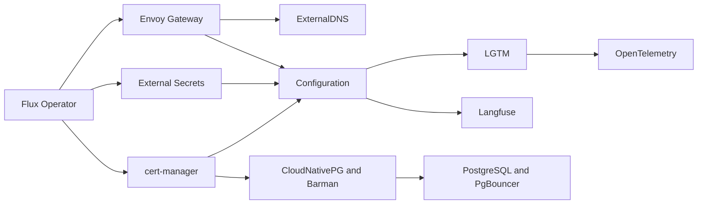

# AKS GitOps

Minimal Flux installs for the Azure dev cluster. Terraform is maintained separately in
[michaelalinks/portfolio-infra](https://github.com/michaelalinks/portfolio-infra), in `main.tf`.
Terraform installs Flux Operator and Flux Instance Helm charts, matching the GKE bootstrap.

## Spin up and tear down

From this repo, with the private `portfolio-infra` checkout at `../../portfolio-infra`:

```sh
az login
make up
make down
```

`make up` initializes/applies Terraform and waits for all platform phases and Helm
releases to become Ready. Flux deploys the committed Git branch configured by
Terraform; local unpushed manifest edits are not deployed. `make plan` previews the
infrastructure changes. Terraform must include the companion PR's lifecycle switches.

`make down` suspends reconciliation, uninstalls applications before their operators,
removes Gateway/DNS configuration, then uses two Terraform applies to remove Flux
before AKS. Shared Azure resources, identities and Blob storage are retained.
PostgreSQL takes a verified external backup before deletion and restores it on
startup. Other cluster-local PVC data and generated application secrets are deleted. Both commands
apply Terraform automatically; state stays in the private infra checkout.

Install Terraform, Azure CLI, kubectl, kubelogin and Python 3. The commands use a
temporary kubeconfig and leave your normal kubectl context alone. Override the
checkout location with `make up INFRA_DIR="/path/to/portfolio-infra"` (or `down`).

## Reconciliation

`flux/flux-system/platform.yaml` contains ten child phases:



Controllers reconcile first. External Secrets reuses its chart-created `eso-akv-wi`
controller account for the Key Vault store. Configuration then creates that store,
Grafana SSO secret, Let's Encrypt issuer, wildcard certificate and public Gateway.
It waits for the store, secret, certificate and Gateway before starting LGTM.
Keeping custom resources behind their controllers prevents an empty cluster from
failing Flux's dry-run validation before the CRDs have been installed.

ExternalDNS reads Gateway HTTPRoutes and manages only `${DNS_ZONE}`, with
TXT ownership `aks-dev`. Grafana is exposed at `https://grafana.${DNS_ZONE}`;
HTTP redirects to HTTPS. Other namespaces can use the shared Gateway by adding
the label `gitops.platform/gateway: public`.

## Observability

LGTM uses maintained, individually pinned charts for Loki, Grafana, Tempo and Mimir.
Grafana's `k8s-monitoring` chart configures its own Alloy collector for Kubernetes
metrics and pod logs. There is no separate Alloy release
or copied collector configuration.

Grafana, Loki, Mimir and Tempo reuse one `lgtm` service account. The configuration
phase creates it before the charts start; Terraform creates the shared Azure
identity and LGTM federated credential before connecting Flux. No chart owns
the shared account, so Grafana can still wait for its backends without a cycle.

Loki and Tempo run as single replicas. Mimir uses its supported classic architecture
with one ingester and no Kafka or MinIO. The remaining values configure Azure
storage, service accounts, Grafana authentication and the minimum dev deployment.

The official OpenTelemetry Collector chart forwards application traces to Tempo,
metrics to Mimir and logs to Loki. Applications can send OTLP to
`opentelemetry-collector.opentelemetry.svc.cluster.local`
on port `4317` (gRPC) or `4318` (HTTP). Applications must emit telemetry themselves;
the chart does not automatically instrument them.

Loki, Mimir and Tempo persist their object data in Azure Blob Storage. Grafana and
backend working data use PVCs. PVCs survive pod restarts, but are not a backup for
cluster deletion: export Grafana dashboards or back up its database if you need
to retain changes made through the UI. The previous cluster's data is not migrated.

## Langfuse

The [official Langfuse chart](https://langfuse.com/self-hosting/deployment/kubernetes-helm)
serves `https://langfuse.${DNS_ZONE}` through the shared TLS Gateway.
It includes PostgreSQL, Valkey, SeaweedFS, ClickHouse and a single Keeper replica
for this dev cluster. The ClickHouse operator and Langfuse share one Flux phase;
Langfuse's HelmRelease waits for the operator, while the phase waits for cert-manager
and the public Gateway through `configuration`. No additional operator phase is needed.

Use built-in accounts, create a Langfuse project, and configure its SDK with the
project API keys and public URL. Application OTLP sent to the collector goes to
Tempo; it is not automatically copied into a Langfuse project. The chart generates
its initial secrets. Langfuse data uses PVCs: back up data and secrets before
cluster deletion if you want to retain projects, traces and accounts.

## PostgreSQL

The [PostgreSQL install and research](flux/installs/postgres/README.md) documents
CloudNativePG, PgBouncer, TLS/SCRAM, dedicated Azure Workload Identity, retained
backups and restoration across recreation. PostgreSQL infrastructure lives in the
private `portfolio-infra` checkout, in a separate `postgres.tf`; its `main.tf`
configures the network policy engine. Review `make plan` before
the first `make up`.
The database phase requires `postgres-settings`, a non-secret ConfigMap created
by the lifecycle command. This database is independent of Langfuse's bundled one.

## Azure bootstrap

Terraform in the personal infrastructure repo installs `flux-operator` and
`flux-instance` charts at 0.61.0 with Flux controllers pinned to 2.9.6. The instance
reads this public repository at `flux`, temporarily from `feat/aks-platform`.
Switch its sync ref to `refs/heads/main` after merging the GitOps PR.

The Helm provider uses your `az login` Entra session through `kubelogin`; install
that helper on the machine running Terraform. AKS retains Entra RBAC and disabled
local accounts. This bootstrap adds no managed identities or federation bindings.
Flux needs no Azure or Git credentials to read this public repository.

Terraform patches the instance's root Kustomization with `wait: false` and
`postBuild.substitute`; child Kustomizations perform readiness checks. It injects
non-secret deployment values into `flux/flux-system/cluster-settings.yaml`:

- `AZURE_TENANT_ID` and `AZURE_SUBSCRIPTION_ID`
- `AZURE_CLIENT_ID` for the single shared managed identity
- `AZURE_STORAGE_ACCOUNT` for LGTM
- `AZURE_KEY_VAULT_URI` and `AZURE_DNS_RESOURCE_GROUP` for shared Azure resources
- `DNS_ZONE`, `ACME_EMAIL` and `CLUSTER_NAME` for domain, certificates and monitoring

Terraform automatically reads `terraform.tfvars` from the infrastructure working
directory when you run `terraform plan` or `terraform apply`. Start with the
populated `terraform.tfvars` committed in the private infrastructure repo.
`terraform.tfvars.example` is available as a template for other deployments. The generated identity client ID, storage account
name and Key Vault URL are taken from Terraform resources and data sources.

The input flow is:

```text
portfolio-infra/terraform.tfvars
  -> main.tf variables and resource outputs
  -> Flux Instance root postBuild.substitute
  -> flux-system/cluster-settings ConfigMap
  -> package postBuild.substituteFrom
  -> Helm values and Kubernetes manifests
```

The existing user-assigned identity serves the AKS control plane, kubelet, DNS, Key Vault
and LGTM storage. Four federation bindings allow the service accounts in
`external-dns`, `cert-manager`, `external-secrets` and `lgtm` to use it; they do not
create additional managed identities. Each workload using it has the combined
Azure permissions assigned to that identity. PostgreSQL uses a dedicated identity
with access only to its own backup container.

The configured Key Vault must contain enabled `grafana-sso-client-id` and
`grafana-sso-client-secret` secrets. The existing Entra application needs the callback
`https://grafana.${DNS_ZONE}/login/azuread`.

## Cluster recreation

Keep the infrastructure node pool's explicit `max_pods = 110`, matching the old
cluster. Omitting it with the current Azure CNI setup leaves 30 slots per node:
the live test filled both nodes' slots despite spare CPU and memory. Changing this
setting on an existing pool requires node-pool replacement; the infrastructure
change is intended for recreation and has not been applied to the live cluster.
Allow subnet addresses and vCPU quota for the chosen pool size and upgrade surge.
Mimir and Langfuse retry transient installation failures, and Langfuse allows
15 minutes for its database startup.

1. After merging the GitOps PR, switch the infrastructure Flux sync ref to `refs/heads/main`.
2. Delete only the old AKS cluster, preserving the shared resource group, its VNet,
   delegated Azure DNS zone and Key Vault. Keep the new Blob Storage account for
   subsequent rebuilds. Review the old Terraform state before retiring its cluster
   resources so it cannot later recreate or manage the replacement cluster.
3. In `portfolio-infra`, initialize Terraform, review the plan and apply it when ready.
   The configuration creates the cluster, identity, roles and federation before
   installing Flux through Helm. Use an AKS version supported by the pinned charts
   (Kubernetes 1.32 or newer).
4. Confirm Flux readiness, Gateway/TLS, Grafana Entra login, and metrics/log ingestion:

   ```sh
   kubectl -n flux-system get kustomizations
   kubectl get helmreleases -A
   kubectl -n envoy-gateway-system get gateway,certificate
   kubectl -n lgtm get httproutes
   kubectl -n monitoring get alloys
   kubectl -n opentelemetry get deployments,services
   kubectl -n langfuse get clickhouseclusters,keeperclusters,httproutes
   ```

Federation is recreated against the new cluster's OIDC issuer; client IDs come from
Terraform rather than being copied from the old manifests. The existing delegated
DNS zone is referenced rather than recreated, so its name servers remain unchanged.
ExternalDNS can manage records it owns; records belonging to the old deployment's
TXT owner need deliberate cleanup if they conflict with the new hostname.

For an in-place platform reset, pause reconciliation before deleting resources.
Uninstall Langfuse before its ClickHouse operator, application releases before
shared configuration, and configuration before its controllers. Wait for each
deletion to finish before resuming the root. Suspended Kustomizations do not prune
their inventory on deletion. If an application phase is suspended, request its
deletion before clearing suspension to permit pruning; resuming it first can
recreate the resources just uninstalled. Pause Flux Instance reconciliation too
(`fluxcd.controlplane.io/reconcile: disabled`) during a platform reset, then resume
it and the root after cleanup.
In-flight Flux health checks can delay deletion until their timeout. Helm retains
some CRDs; remove them only after their custom resources are gone. Deleting AKS
itself removes its Kubernetes API and CRDs.

## Live lifecycle test

On 10 October 2026, all twelve platform Helm releases and nine Flux Kustomizations
reached Ready before and after an in-place platform deletion. Grafana and Langfuse
HTTPS health checks passed, Mimir returned collected metrics, Loki returned fresh
pod logs, and a trace sent through OpenTelemetry was read back from Tempo.

Deletion removed platform namespaces, releases, custom resources and persistent
volumes. Thirty-four chart-retained CRDs were removed normally after checking they
were empty. AKS, Flux bootstrap and Azure Blob storage remained in place.

This run required Helm and Kustomize controller restarts after a test-ordering race
briefly recreated application releases during teardown. The reset instructions
above were corrected; an uninterrupted full cycle using that correction has not
yet been verified. Reinstallation completed without manual workload fixes; Mimir's
initial gossip startup failure recovered through its configured automatic retry.

## Validation

With Python 3.12+, Helm 3 and kubectl installed:

```sh
python3 -m venv .venv
.venv/bin/pip install -r scripts/requirements.txt
.venv/bin/python scripts/validate.py
```

CI runs the same checks: Kustomize builds, chart lint/rendering, custom-resource
schemas, dependency cycles, CRD prerequisites (including Helm dependency ordering) and HTTPRoute backend service/port.
Validation downloads pinned charts and Flux schemas and does not contact AKS.

## Linear issue check

Pull requests call the pinned `ops-shared/linear-issue.yml` workflow. Every Linear
issue ID in the source branch must resolve to an accessible issue in the connected
workspace. Use Linear's copied branch name, such as `michaelalinks/ai-28-postgres`.
The caller passes `LINEAR_CLIENT_ID` and `LINEAR_CLIENT_SECRET` from Actions secrets;
the shared validator obtains a read-only OAuth token for each run. Missing issue
IDs, inaccessible issues, missing credentials, and API errors fail the check.

The `linear-issue-required` gate fails if validation fails or is skipped. Require
that check in the default-branch merge rules to enforce it at merge time. Give this
repository access to the organization's Linear Actions secrets. No broader shared
engineering policy or lint workflow is enabled by this integration.

## Existing extension migration

The replacement Terraform removes the managed extension and Azure Flux configuration.
For an existing cluster, do not apply their deletion alongside the new Helm releases:
first disable the old root's pruning and suspend reconciliation, then remove the
Azure Flux configuration and extension before installing Flux Operator. Review
retained controller resources for Helm ownership conflicts during that handover.
A fresh cluster needs no handover.
